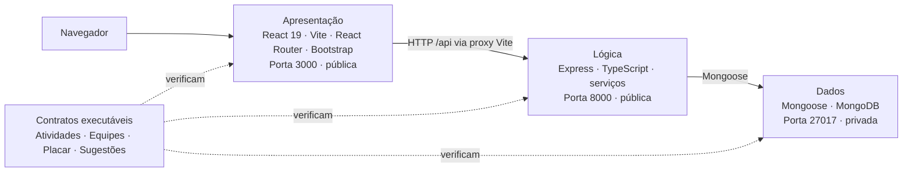

# Arquitetura do OctoFit Tracker

O OctoFit Tracker é uma aplicação de três camadas para um programa de atividades físicas escolar. O código inicial inclui contratos de API e pontos de implementação intencionalmente incompletos para que você use o modo agent do GitHub Copilot em um ciclo guiado por testes.

## Limites entre as camadas

- **Camada de apresentação**: React 19, Vite, React Router, Bootstrap e um cliente compartilhado da API em `octofit-tracker/frontend/src`.
- **Camada de lógica**: rotas e serviços Express com TypeScript em `octofit-tracker/backend/src` expõem o comportamento `/api/*` na porta `8000`.
- **Camada de dados**: modelos Mongoose e dados de demonstração em `octofit-tracker/backend/src/models` e `src/scripts/seed.ts` são persistidos no MongoDB na porta `27017`.

## Portas e regras de ambiente

- MongoDB: `27017` (privada)
- API Express: `8000` (pública)
- Interface Vite: `3000` (pública)
- O navegador acessa caminhos relativos `/api`. O Vite os encaminha para `http://localhost:8000`; `VITE_API_BASE_URL` pode substituir a URL-base.
- Não encaminhe nem torne públicas outras portas.

## Contrato da API

| Capacidade | Método e caminho | Comportamento esperado |
| --- | --- | --- |
| Registro de atividades | `GET /api/activities`, `POST /api/activities` | Lista e cria atividades válidas. POST recebe `userId`, `teamId`, `type` e `minutes`; `userId` e `teamId` devem ser IDs bem-formados de uma pessoa e uma equipe existentes, caso contrário a API retorna um 4xx intencional (nunca um 500 causado por erro de conversão). Uma atividade criada armazena `user`, `team`, `type` e `minutes` enviados, além de `points` e `occurredAt` calculados. |
| Equipes | `GET /api/teams`, `POST /api/teams` | Lista e cria equipes com integrantes. As equipes criadas e listadas mantêm os valores enviados em `name` e `mascot`. Rejeita uma equipe sem nome com `400`. |
| Placar | `GET /api/leaderboard` | Retorna as equipes ordenadas pela soma dos pontos de suas atividades, da maior para a menor. Cada item contém `teamName`, `totalPoints` e uma `rank` iniciada em 1. |
| Sugestões de treino | `GET /api/workouts/suggestions/:userEmail` | Recomenda treinos com base nos padrões de atividade recentes da pessoa correspondente ao e-mail seed. O foco da primeira sugestão (`focus`) corresponde à meta ou à atividade recente dessa pessoa, e o campo `reason` explica o motivo. Um e-mail sem pessoa correspondente retorna um 4xx intencional (por exemplo, `404`). |

## Decisões de implementação

Plano registrado antes de qualquer edição de código. Cada decisão segue as instruções de backend e frontend em `.github/instructions`.

- Decisão da camada de apresentação: os componentes em `octofit-tracker/frontend/src/components` apenas renderizam. As requisições ficam em `src/api/client.ts` (uso obrigatório) e em funções tipadas por recurso. Cada recurso exibe carregamento (`role="status"`), vazio, erro (`role="alert"`) e sucesso em português do Brasil. `CapabilityCard` deixa de exibir "Implementação pendente". Equipes mostram a quantidade de integrantes, pois a API devolve IDs, não nomes. Tipos de atividade (`run`, `cycle`, `strength`) recebem rótulos em português na apresentação; os códigos permanecem no dado.
- Decisão da camada de lógica: a validação de entrada fica nos serviços de `octofit-tracker/backend/src/services/octofitService.ts`, retornando 400 para entradas inválidas e 404 para referências inexistentes. Erros internos continuam com 500. Não há autenticação neste exercício.
- Decisão da camada de dados: as regras de obrigatoriedade ficam nos esquemas Mongoose (`User`, `Team`, `Activity`, `Workout`). Não adicionamos `enum` para não restringir os códigos de domínio já usados nos testes. Os dados de demonstração continuam sendo gravados apenas por `seed.ts` com upsert.
- Abordagem para registro de atividades: `POST` valida `userId` e `teamId` como ObjectId bem-formados (400 caso contrário), verifica que pessoa e equipe existem (404 caso contrário), valida `type` não vazio e `minutes` numérico positivo (400). `points` é calculado a partir de `minutes` (1 ponto por minuto), e `occurredAt` recebe a data atual. Não exigimos que a pessoa pertença à equipe informada; isso é uma pendência de regra de negócio a confirmar.
- Abordagem para gerenciamento de equipes: `POST` rejeita nome ou mascote ausente com 400 e grava `name`, `mascot` e `members` (IDs validados). Não sincronizamos `User.team` ao criar equipes; isso também fica como pendência.
- Abordagem para o placar: agregação de `Activity` por equipe, com soma de `points`, incluindo todas as equipes (com 0 pontos quando não houver atividades). Ordenação decrescente com desempate pelo nome, e `rank` iniciando em 1.
- Abordagem para sugestões de treino: o e-mail é normalizado para minúsculas e a pessoa é buscada por ele (404 se não existir). O foco vem da atividade mais recente (`run` e `cycle` mapeiam para `endurance`; `strength` para `strength`) ou, sem atividade, da `fitnessGoal`. A sugestão é o treino com esse foco, ordenado por título, e `reason` cita a atividade recente em português (por exemplo, "Baseado na sua atividade recente de corrida"). Na tela, a pessoa padrão é `mona@example.com`, pois não há autenticação.

## Estado atual dos testes

Resultados observados em 19/11/2026 antes de qualquer implementação:

- `npm run test:data --prefix octofit-tracker/backend`: 4 falhas, 1 aprovado. As falhas são `expected undefined to be defined` porque os esquemas não declaram campos obrigatórios. O teste de seed idempotente passa e precisa continuar passando. **Após a mudança nos modelos (campos obrigatórios em `User`, `Team`, `Activity` e `Workout`): 5 de 5 passam.**
- `npm run test:api --prefix octofit-tracker/backend`: 4 de 4 falham. Criar atividade retorna 501 em vez de 400; criar equipe também retorna 501; o placar retorna `[]`; a sugestão retorna o primeiro treino qualquer, não o compatível.
- `npm test --prefix octofit-tracker/frontend`: 15 de 15 falham. Todas as telas são o placeholder `CapabilityCard` sem `role="status"` com "carregando", sem dados, sem estado vazio e sem alerta de erro.
- `npm run build --prefix octofit-tracker/backend` e `npm run build --prefix octofit-tracker/frontend`: passam. A compilação não cobre o comportamento.
- `npm run seed --prefix octofit-tracker/backend` (duas execuções no MongoDB local `octofit_db`, porta 27017): cria 2 pessoas, 2 equipes, 2 atividades e 2 treinos. A segunda execução não altera nenhum documento, confirmado por um resumo idêntico de todos os documentos, incluindo `_id`.

## Ordem segura de implementação

1. Dados: adicionar validações obrigatórias nos esquemas. Corrige os 4 testes de dados e preserva o seed idempotente.
2. API de atividades e equipes: validação de entrada, referências e cálculo de pontos. Corrige 2 dos 4 testes de API.
3. Placar: agregação por equipe. Depende das atividades gravadas corretamente.
4. Sugestões de treino: depende de atividades e da `fitnessGoal`. Corrige o último teste de API.
5. Frontend: um cliente tipado por recurso, depois os estados de carregamento, vazio, erro e sucesso em cada tela. Depende do contrato da API.

Cada etapa só avança com os testes da etapa anterior verdes. Mudanças pequenas, sem regeneração ampla.

## Plano de testes

Comandos a executar a cada etapa e o significado de cada falha atual. Não adicionamos testes novos além dos existentes, salvo se uma regra nova não estiver coberta.

- Testes da camada de dados: `npm run test:data --prefix octofit-tracker/backend`
- Testes da API: `npm run test:api --prefix octofit-tracker/backend`
- Testes do frontend: `npm test --prefix octofit-tracker/frontend`
- Compilação do backend: `npm run build --prefix octofit-tracker/backend`
- Compilação do frontend: `npm run build --prefix octofit-tracker/frontend`
